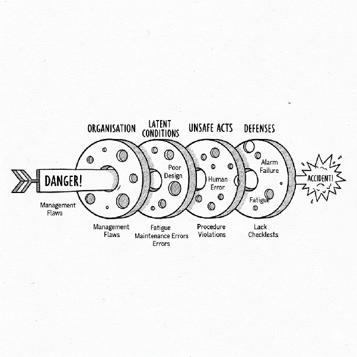

## Mythe \#2

Les accidents sont dus à des erreurs humaines.

### Un biais rétrospectif

Tant que le matériel n’est pas directement en cause (ex : la voile ne casse pas), il sera toujours possible à posteriori de rationaliser les fautes commises par un accidenté. C’est d’ailleurs spontanément ce que nous faisons dans nos “débriefings” formels ou informels. A la fin, avec ou sans elle, ce sera toujours la faute de la victime. Sa technique, son analyse, son engagement, le choix de sa voile, sa fatigue, son stress, son placement et surtout ses décisions... Si elle a fini par terre un peu trop durement, c’est bien qu’elle a raté quelque chose à un moment donné non ?\!  
Notre méthodologie offre là un parfait exemple de biais rétrospectif tel que largement étudié dans la littérature scientifique dès les années 1970 notamment par Daniel Kahneman[^9] (et coll.). Une fois le résultat connu, avec l’utilisation d’un temps long et l’ensemble des éléments à disposition, il sera toujours possible pour un observateur extérieur de rationaliser à posteriori les causes d’un accident afin de les imputer à une erreur humaine. C’est précisément cette méthode qui permet au système de garder de la confiance dans ses propres croyances et notamment le fait que le parapente est un activité sûre dont les risques peuvent être maîtrisés.

### Des victimes boucs émissaires

Je vois la communauté s’enfoncer dans un réflexe d’autoprotection très négatif. Les accidentés sont nos moutons noirs. Une victime est quelqu’un qui a fait une bêtise, suspicieusement même, un “sous-pilote”, une tête brûlée ou un inconscient. Le manque d’empathie est criant, le jugement instantané. La conséquence directe est que les victimes ont honte. La plupart des accidentés romancent complètement leur récit, minimisent ce qui leur est arrivé ou n’en parlent pas. Certains même se cachent et prétendent que rien ne s’est passé. Les accidents dont les conséquences ne sont pas gravissimes, immédiates ou de notoriété publique sont rarement reportés. Il fût un temps où même l’utilisation du parachute de secours était jugée suspicieuse \! Heureusement, son utilisation massive en parapente de voltige et le slogan : “Un tour, c’est secours” contribuent désormais à encourager les pilotes à utiliser leur parachute et à pouvoir l’assumer avec moins de complexes.

Si le mythe sert d'agrégateur, de communion symbolique autour de croyances et de valeurs partagées par un ensemble d’individus, les anthropologues savent aussi depuis longtemps que les crises menaçant l’unité se résolvent par la désignation d’un bouc émissaire. Ce dernier représente la racine du problème qui menace le raisonnement collectif. Ethnologiquement, c’est ce qui permet d'appréhender l’organisation des sacrifices humains. Massacrer un bouc émissaire, de préférence de façon collective ou ritualisée avec un représentant officiel, notable de la communauté, permet de ramener l’ordre, la logique, la tranquillité et de déculpabiliser tout le monde. 

- “Il n’a pas plu depuis longtemps mais le Dieu de la pluie ne nous a pas abandonné. C’est juste cet imbécile de bouc émissaire qui l’avait couroussé… On s’en est occupé, tout va rentrer dans l’ordre à présent”. (Et de continuer de croire paisiblement au Dieu de la pluie).

Beaucoup d'accidents bousculent le mythe du parapente “sûr” entretenu par notre communauté. Nos victimes sont dès lors traitées comme des boucs émissaires. Nous les sacrifions symboliquement sur l’autel de notre croyance principale. Nous organisons aussi des lynchages publics de temps à autre. Pas avec la même violence ni la même ferveur qu’autrefois mais il n’y a qu’à lire les commentaires des vidéos d’accident sur les réseaux sociaux pour s’en persuader. Tout le monde semble se transformer à minima en une sorte d’expert au ton condescendant... Souvent l’auteur, lui-même, se confond en excuses et explique sa grossière erreur en guise même d’introduction.

C’est à ce prix que le mythe d’une activité sûre au risque maîtrisable est préservé parce qu’en toute logique, la victime est jugée fautive de n’avoir pas maîtrisé son vol. Le raisonnement est extrêmement confortable puisqu’il permet immédiatement de se désolidariser en tant que pratiquant de l'accident et de continuer à penser que tout ira bien puisque potentiellement “je n’aurais pas fait cette erreur et donc je n’aurais pas eu d’accident”. Et de fait, notre communauté pense majoritairement que : “les risques de l’activité sont maîtrisables mais les accidents sont dus à des erreurs de pilotes”.

C’est ce qui explique aussi l’empathie particulière des parapentistes envers les pilotes tombés. En dépit d’une accidentalité épaisse et répandue dans le monde entier, il n’existe aucune association spécialisée d’aide aux victimes : “Elle a fait une erreur”. “Je lui avais dit”.  “ça devait arriver”. Les collectes de fonds en ligne visant à rechercher ou retrouver les disparus de notre communauté font généralement le plein en quelques heures alors que ce n’est plus automatiquement le cas dès lors qu’il s’agit d’aider les proches d’un pilote qui est effectivement retrouvé polytraumatisé ou décédé. La même personne peut voir son statut passer de : quelqu’un qui est perdu et qui nécessite du secours, à quelqu’un qui a fait une bêtise. 

### Un autre éclairage

Le piège logique est manifeste parce qu’en réalité, aucune victime n’a désiré son accident. Chaque pilote a même sûrement fait de son mieux pour y échapper. S’il est une caractéristique intéressante de l’intelligence humaine c’est justement sa propension à faire des erreurs. “Errare humanum est \[...\]”. La traduction de “l’erreur est humaine” devrait aussi être plus particulièrement l’écho de : “Je suis un humain et donc je fais des erreurs”. Nos pilotes les plus prudents font des erreurs. Même nos plus grands champions se trompent également et à l’occasion ils tombent à cause d’une bêtise. L’accidentalité touche tout le monde. Cela ne signifie pas du tout qu’il faille se montrer fataliste et encore moins l’accepter et je vais revenir sur cette notion. Toutefois, le caractère “maîtrisable” des risques en parapente n'apparaît-il pas dans ce contexte particulièrement illusoire ? Et si ceux qui sont tombés aujourd’hui avaient été touchés par la statistique et/ou la malchance (\!) juste un peu plus tôt par rapport à ceux qui tomberont demain ?

Dans un paradigme moins cognitiviste et davantage basé sur les théories des systèmes dynamiques ou dans les perspectives de l’action située, il est entendu que l’erreur ou la série d'erreurs qui conduit à l’accident est déjà une partie du symptôme ; c'est-à-dire une conséquence qui trouve une racine plus profonde et plus systémique. L’erreur n’est pas dissociable de l’accident ; elle en constitue une de ses parties. Si l’on cherche des mécanismes explicatifs pour réduire l’accidentalité, il faut absolument gagner un niveau d’abstraction et élargir le focus autour des erreurs pour tenter de comprendre non pas ce qu’elles sont mais leurs conditions d'émergence \!

Les accidents ne sont pas dus à des erreurs humaines.  
Ce sont éventuellement des erreurs humaines qui ont mal tourné.  
    
Dire « erreur », c’est déjà juger. Le mot suppose une norme connue d’avance : une bonne action que le pilote aurait dû produire et qu’il n’a pas produite. Or cette norme, nous ne la connaissons le plus souvent qu’après coup, une fois l’issue connue. Sur le moment, le pilote a pris la décision qui lui semblait sensée, avec les informations dont il disposait, la fatigue qui était la sienne et la pression du groupe ou de la journée. Sidney Dekker invite justement à chercher pourquoi l’action du pilote avait du sens pour lui au moment où il l’a faite[^c-dekker-fg].

Ce que nous appelons « erreur » est souvent une adaptation ordinaire. Elle fonctionne cent fois et, la cent-unième, elle rencontre une configuration défavorable : un thermique plus violent, un gradient, un autre pilote au mauvais endroit. Erik Hollnagel décrit ces compromis permanents entre efficacité et minutie que chacun de nous fait sans y penser[^c-hollnagel]. La même décision fait de nous un bon pilote un jour et un « inconscient » le lendemain, selon l’issue.

D’ailleurs il y a de nombreuses erreurs qui ne mènent pas à l’accident. Certaines sont parfois extrêmement grossières et l’on se dit que pour le coup, le pilote l’a vraiment échappé belle \! Nous avons aussi tous en tête tel exemple de pratiquant à qui il arrive toujours quelque chose depuis près de 30 ans et qui pourtant n’en a jamais réellement subi aucune conséquence. Tout cela contribue à l’illusion d’un sport qui pardonne. Des erreurs, grossières ou répétées, ne mènent pas à l’accident.

A côté de cela, nous voyons des victimes rater pour la toute première fois un décollage et chuter mortellement. Ce qui transforme l’erreur en accident mortel est le fait que la situation tourne mal. Parfois cela peut être imputé à un mauvais hasard, au fait des choses, parfois non. 

Et puis il existe même des cas, où il n'y pas d'erreur du tout !
Des moments où tu subis les erreurs des autres, des accidents liés au matériel (si si!), des défauts en tout genre liés au système : un mauvais cable signalé nul part, une course non stoppée qui dégénère sous un orage.

En tout cas, il est une vision ou les accidents ne sont pas seulement dus à des erreurs humaines. Les erreurs humaines arrivent tout le temps et sont plutôt des constantes de notre système humain. Elles sont présentes à n’importe quel niveau d’expérience et de pratique et arriveront qu’on le veuille ou non y compris avec toute la connaissance de soi et toute la prévention du monde.

Cette déclaration ne manquera pas de sonner “fataliste” aux tenants du paradigme actuel. “Alors on ne peut rien faire ?”. Ce malentendu provient justement de leur incapacité à comprendre la possibilité d’action offerte en plus de l’humain, par le système. Pour une catégorie identifiée d’erreur, un système de protection collectif peut empêcher son émergence en amont. Et même en aval, c'est-à-dire après son occurrence, il est encore possible de solidifier la pratique pour éviter qu’une bêtise effectivement commise ne dégénère dans d’horribles circonstances.

L’aviation de ligne a tiré les conséquences de ce constat avec le *Threat and Error Management* (TEM), développé à la fin des années 1990 par l’équipe de Robert Helmreich à l’Université du Texas, puis repris par l’Organisation de l’aviation civile internationale[^c-tem]. Le principe est simple. Les menaces (météo, relief, trafic, fatigue, matériel…) et les erreurs sont considérées comme normales et inévitables. L’enjeu n’est plus de les supprimer mais de les détecter tôt, de les gérer, et d’éviter qu’elles ne conduisent à un « état indésirable » de l’appareil, puis à l’accident.

Transposé au parapente : une rafale au décollage est une menace, un gonflage mal contrôlé une erreur, une voile partie de travers au ras de la pente un état indésirable. À chaque étape, il existe des protections possibles. Certaines sont individuelles, mais beaucoup sont collectives : une aire de décollage dégagée, une manche à air bien placée, un pilote qui assiste, une règle d’usage du site. C’est ce regard qui nous manque.

### Deux conceptions de l’accident

Nous pouvons dès lors distinguer deux systèmes tentant de caractériser ce qu’est fondamentalement un accident de parapente. Ces deux cadres d’analyse sont très différents et ont des conséquences radicales sur les remédiations préférentielles envisagées.  Je veux essayer de synthétiser les deux approches pour mieux les illustrer. Elles ne s’excluent pas complètement à proprement parler mais la différence de paradigme sous-jacent est manifeste et pose des problèmes de communication importants au sein de notre communauté.

1\) La pratique du parapente est sûre et maîtrisable…  
⇔  
2\) …mais les accidents sont dus à des erreurs humaines

Dans ce cas, nous collectons naturellement un catalogue d’erreurs et d’accidents :

- “Comment le pilote a-t-il fait ?”. “Qu’est-ce qu’il a fait ?”  
- “Qu’a-t-il raté ?”  
- “Qu’est-ce qui lui a manqué ?”  
- “Qu’aurait-il dû faire ?”

Cette vision essentiellement cognitiviste considère l’individu et son traitement de l’information comme responsable des actions motrices et de la réponse associée. L’accident est ici un déficit entre une attente imposée par l’environnement et la production insuffisante ou défaillante d’un pilote qui est elle-même due à au traitement cognitif qu’il réalise face à la tâche. L’accident est donc ici : “dû à une erreur humaine”.

Cette réflexion est centrée sur les modalités d’actions et les ressources disponibles pour le pratiquant. Qu’est-ce qu’aurait pu améliorer l’individu ?

La formation (\!) des pratiquants va presque systématiquement être mise en avant comme vecteur évident de réduction de l’accidentalité. Si les accidents sont dus à des erreurs humaines, la tentation naturelle est de réduire les erreurs des pilotes afin qu’ils subissent moins d’accidents. Et c’est exactement dans ce sens, que le pratiquant, son moniteur ou son formateur se retrouvent être les acteurs principaux de la sécurité puisqu’ils sont au cœur des dispositifs de formation. 

L’étude des facteurs humains se révèle incontournable pour prévenir et renforcer la connaissance de soi de chaque pratiquant. Les pilotes mieux formés et avertis des pièges du fonctionnement humain seront moins susceptibles de faire des erreurs et donc de subir un accident.  
1\) En parapente, la sécurité du pratiquant est engagée en cas d’erreur \[...\]  
⇔  
2\) Les humains font des erreurs

Face à cette problématique épineuse, nous pourrions nous poser ce genre de question : 

- “Que s’est-il passé ?”  
- “Comment la victime s’est-elle faite avoir ?”  
- “Qu’est-ce qui peut être fait pour éviter ce même genre d’erreur à d’autres à l’avenir ?”

Dans une perspective dynamique, l'erreur et l’accident participent de la même chose. La situation propose un réseau de contraintes trop fortes auquel l’individu ne peut pas s’adapter en temps réel. Le traitement cognitif qu’il en fait importe moins puisqu’ici l’accident est le produit de l’émergence d’une erreur (toujours possible) avec ses conséquences. C’est une erreur humaine qui tourne mal dans une situation donnée.

Cette réflexion est ouverte sur des causes individuelles et extra-individuelles. Qu’est-ce qui aurait pu protéger l’individu ? 

Les erreurs sont une contrainte du système humain, une forme d’écueil impossible à éviter complètement y compris à travers la formation et la connaissance de soi. Il faudrait davantage enrayer l'émergence des pièges les plus significatifs pour les pratiquants. Rassembler les familles d’erreurs partageant la même classe de problème et inventer une protection collective afin que les pratiquants n’aient pas à se soucier de se retrouver dans cette situation.

L’étude des facteurs humains est avant tout l’occasion de comprendre les fonctionnements individuels pour édifier de futures protections collectives / systémiques pour les pratiquants.  Former et prévenir est souvent insuffisant pour prémunir les individus de tomber dans les travers de leur propre fonctionnement.

| Paradigme | La pratique est sûre et maîtrisable \[…\]                       ⇔ Les accidents sont dus à des erreurs humaines | La sécurité du pratiquant est engagée en cas d’erreur \[...\]                       ⇔ Les humains font des erreurs  |
| :---- | :---- | :---- |
| Accident | Dû à une erreur humaine | Erreur humaine qui a mal tourné |
| Questions | Comment le pilote a-t-il fait ? Qu’a-t-il raté ? Qu’est-ce qui lui a manqué ? Qu’aurait-il dû faire ?  | Comment la victime s’est-elle faite avoir ? Qu’est-ce qui peut être fait pour éviter ce genre d’erreur à l’avenir ? |
| Remédiation | Individuelle. Cognitiviste. | Collective. Systémique. Complexe et multifactorielle (action située). |
| Pratiquant | À former / renforcer. | Imparfait face à l’erreur. A protéger. |
| Accidenté | “A fait une erreur”. Empathie difficile. Effet bouc émissaire. | “S’est fait avoir”. Victime. Compassion. Effet faire évoluer de système |
| Facteur Humain | Pour prévenir et faire progresser le pratiquant | Pour connaître les failles individuelles et améliorer le système |
| Acteur principal | Pilote lui-même. Moniteur. Formateur.  | Pilote lui-même. Moniteur. Formateur. Collège d’experts. Communauté. Institution. Législateur.  |

### Implication en terme de gestion de la sécurité

Je crois que nous gagnerions à changer de paradigme et à abandonner pour de bon la croyance de l’accident due à une erreur humaine. Cette approche exclut la recherche de causes externes et systémiques alors qu’à l’inverse une recherche plus globalisée sur les conditions d'émergence des erreurs des pilotes n’exclut pas d’envisager ni les parcours de formation ni les facteurs humains.

Changer de paradigme ne signifie pas déresponsabiliser les pilotes. Cela signifie changer la question que nous posons après un accident. Au lieu de « qu’a-t-il raté ? », demander « qu’est-ce qui a rendu cette erreur possible, et qu’est-ce qui aurait pu en limiter les conséquences ? ». La première question produit un coupable et un sentiment de sécurité pour ceux qui restent. La seconde produit des pistes d’action : un site à réaménager, une information à diffuser, un usage à changer, un matériel à améliorer, un contenu de formation à revoir.

En matière de gestion de la sécurité, cela implique trois choses :

- Collecter les accidents et les incidents sans chercher de faute, sinon personne ne parlera.
- Analyser ces événements par familles plutôt qu’un par un, pour repérer les scénarios qui reviennent.
- Répartir les remédiations entre tous les acteurs : pilotes, moniteurs, fabricants, gestionnaires de sites, organisateurs, fédérations.

La formation y garde toute sa place, mais elle cesse d’être notre seule réponse.

### Le modèle de James Reason

Dans les années 1990, James Reason a développé une théorie qui est devenue incontournable. Elle est bien connue de notre milieu et je suis certain que le schéma ci-dessous évoquera immédiatement quelque chose au lecteur.  
**

Reason, est l’un des premiers auteurs à modéliser une méthodologie de gestion des risques en s'intéressant à ce qu’il appelle des “défaillances”. Il a catégorisé trois sources potentielles :

- Les défaillances techniques  
- Les erreurs humaines  
- Les défaillances d’organisation

C’est par lui que l’on a commencé à considérer “l’erreur inséparable de l’intelligence humaine”. Sa conception de la gestion de la sécurité consiste à empiler des éléments de protection que l’on sait individuellement imparfaits mais dont l’ensemble finira par conférer au système une fiabilité acceptable. Les trous dans chacune des plaques représentent bien cette imperfection inhérente à chacun des éléments. Reason montre comment il est nécessaire d’en ajouter beaucoup et de jouer sur leur complémentarité pour diminuer les probabilités d’accidents. Cette complémentarité provient de la diversité des protections utilisées. Si les accidents sont jugés trop nombreux et le système peu fiable, c’est que des plaques sont manquantes où que leur nature ne diffère pas suffisamment de l’une à l’autre; elles ont alors vraisemblablement toutes les mêmes trous.

Les plus grands penseurs en matière de sécurité de notre communauté ont repris ce modèle théorique avec succès pour proposer une méthodologie de gestion du risque appliquée au parapente. Jean-Marc Galan[^10] est certainement le plus célèbre d’entre eux au travers de son ouvrage référence puis de sa conférence adroitement nommée : “La revanche d’Icare”.

Pourtant, le modèle de Reason que l’on nous propose systématiquement dans sa version parapente ne s'intéresse toujours qu’à la seule partie des erreurs humaines. Lorsque l’on regarde l'enchaînement de plaques qui sont présentées, on ne trouve que des protections qui concernent l’individu dans sa pratique : son mental, son physique, sa technique, sa connaissance du milieu etc... Et ce faisant, nous ne nous intéressons en réalité qu’au tiers de ce que préconise Reason. Exit les protections organisationnelles, exit les protections matérielles. Dans ses différentes versions, les meilleurs auteurs de notre communauté cherchent tous à prévenir ou former pour réduire les éventuels “trous” des systèmes de protection individuel des pilotes. C’est extrêmement utile et nous y reviendrons mais ce n’est pas exactement ce que propose de faire Reason dans son modèle de gestion des risques. Pendant que nous cherchons à réduire les trous dans chacune des plaques, il propose d’en positionner d’autres : organisationnelles et matérielles pour bloquer les défaillances résiduelles. Nous devons accepter que les plaques qui protègent les pilotes de leurs propres erreurs humaines ont et auront toujours des trous. A cette seule condition, nous chercherons les autres boucliers organisationnels et matériels pour protéger tel ou tel type de pratiquant dans tel ou tel contexte. 

C’est précisément ce que nous ne pouvons pas faire en restant sur le paradigme qui concentre ses perspectives de remédiation sur la formation des pilotes. Aucun pilote ne sera jamais complètement “fini” ni “hors de danger”. L’éducation et la prévention ne sont pas des éléments qui s’achèvent un jour et c’est la raison pour laquelle en dépit d’un dispositif de formation parmi les plus aboutis du monde, avec des acteurs de grande qualité, les statistiques françaises continuent de montrer un système global de gestion du risque peu fiable. Nous ne renforçons tout simplement pas ce qu’il faut.

Peut-on croire que les penseurs de notre communauté, aussi brillant fussent-ils, aient des difficultés à imaginer un modèle de plaques de Reason plus exhaustif traitant aussi les défaillances organisationnelles et les défaillances techniques ? Pas une seule seconde. Les raisons pour lesquelles les auteurs n’illustrent pas leur propos de cette façon sont principalement de deux ordres :

Premièrement le travail individuel de formation et de gestion du risque individuel est essentiel. C’est la préoccupation majeure et légitime des pratiquants et chacun doit effectivement se responsabiliser et s’autonomiser face aux risques inhérents à sa pratique. C’est un travail de fond pour lequel il manquait de toute façon des références.

Ensuite, il faut évoquer le paradigme dominant de notre communauté et la culture délibérément “LIBRE” du parapente en particulier en France et en Europe. Les idées en matière de sécurisation collective ne manquent pas mais il est pour le moment excessivement difficile et impopulaire de tenter de faire accepter des couches institutionnelles ou organisationnelles de sécurisation. Ces dernières sont perçues comme des restrictions dans la pratique des membres de la communauté. Il y a une vraie convergence d’intérêt à continuer de parler des accidents comme de quelque chose que l’on doit aux erreurs des autres parce que cela permet d’éviter un nouvel ensemble de boucliers organisationnels ou matériels jugé liberticide. Après tout, “on ne va quand même pas punir toute une communauté parce que certains sont des dindons[^11] n’est-ce pas ?”.

Je veux préciser que je suis tombé comme d’autres dans ce travers et dans cette croyance étant plus jeune. J’ai signé une tribune virulente lorsque les institutions fédérales (Commission Internationale de Vol Libre et Fédération Française de Vol Libre) ont interdit l’usage des prototypes et des voiles non homologuées au sein de leur circuit de compétitions[^12]. Ironie de l’histoire, une paire de journées avant de signer ce texte,  je venais moi-même de tomber lourdement aux manettes de l’un de ces engins.

### Des facteurs humains détournés

Il faut aller plus loin, car même le travail sur les facteurs humains a été détourné de sa nature. À l’origine, les facteurs humains sont une discipline d’ingénieurs et d’ergonomes. Juste après la Seconde Guerre mondiale, Paul Fitts et Richard Jones étudient des centaines d’« erreurs de pilotage » dans l’US Air Force. Leur conclusion est restée célèbre : la plupart de ces erreurs s’expliquent par la conception des commandes et des instruments, et c’est le cockpit qu’il faut corriger, pas le pilote[^c-fitts]. Toute la discipline est née de ce renversement : connaître les limites de l’humain pour lui construire un système qui les tolère.

En parapente, nous avons gardé les mots et inversé le sens. Les facteurs humains sont devenus un catalogue de biais et de pièges mentaux : la pression de l’objectif, l’excès de confiance, l’effet de groupe, la fatigue, la lecture sélective de la météo. Ce travail est précieux pour se connaître, et il a fait progresser la formation. Mais dans le débriefing d’un accident, il sert le plus souvent à une seule chose : expliquer ce que la victime aurait dû voir en elle-même. Le pilote n’est plus seulement coupable de son erreur, il est aussi coupable de ne pas avoir su déjouer ses propres biais. La connaissance qui devait le protéger sert désormais à l’accabler.

Sidney Dekker décrit précisément ce glissement. Dans ce qu’il appelle l’« ancienne vision », l’erreur humaine est la cause de l’accident, et le travail consiste à trouver qui s’est trompé. Dans la « nouvelle vision », l’erreur humaine est le symptôme d’un problème plus profond du système, et le travail commence là où l’enquête de l’ancienne vision s’arrête[^c-dekker-fg]. Nous utilisons les outils de la nouvelle vision au service de l’ancienne.

Utilisés fidèlement à leur nature, les facteurs humains devraient nous conduire à une autre question. Puisque nous savons que les pilotes sont sensibles à la pression de l’objectif, qu’ils lisent mal la météo quand ils ont fait deux heures de route, qu’ils se laissent entraîner par le groupe, que pouvons-nous changer autour d’eux pour que ces pièges se referment moins souvent ? C’est cela, aider le pilote systémiquement : non pas lui demander d’être plus fort que sa nature, mais construire un système qui la prend en compte.

[À COMPLÉTER : un exemple de débriefing ou de compte rendu d’accident où les facteurs humains ont servi à accabler le pilote.]

Avant d’aller plus loin dans l’étude des croyances et de l’imaginaire de notre communauté, il convient de s'arrêter sur cette notion essentielle de liberté et sa confrontation systématique avec la réglementation, la norme et les systèmes de gestion collectif. Tentons de comprendre ce que le concept de vol libre recèle réellement et la façon dont il s’articule avec la sécurité des pratiques.

[^9]:   L’ouvrage de référence à ce sujet est : Thinking, fast and slow par Daniel Kahneman en 2011

[^10]:  Jean-Marc Galan en 2019 : Gérer les risques en parapente.

[^11]:  Le dindon n’est pas le meilleur des volatiles

[^12]:  Lettre au comité directeur de la FFVL 30 Juillet 2011\.

[^c-dekker-fg]:  Sidney Dekker en 2006 : The Field Guide to Understanding Human Error (troisième édition en 2014).

[^c-hollnagel]:  Erik Hollnagel en 2009 : The ETTO Principle: Efficiency-Thoroughness Trade-Off.

[^c-fitts]:  Paul M. Fitts et Richard E. Jones en 1947 : Analysis of factors contributing to 460 « pilot-error » experiences in operating aircraft controls, US Army Air Forces, Aero Medical Laboratory.

[^c-tem]:  Voir notamment OACI, Doc 9803 : Line Operations Safety Audit (LOSA), 2002, qui présente le modèle TEM.
