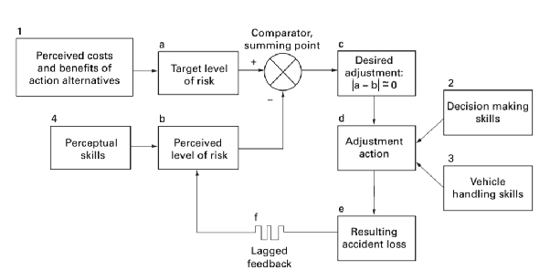

## Mythe \#5

La théorie de l’homéostasie du risque rend impossible la réduction de l’accidentalité par des mesures externes puisqu’elle suppose que le risque cible des pratiquants sera toujours inchangé indépendamment de l’environnement. 

### Une caution théorique mal interprétée

Ce mythe sert de défense et de caution théorique au paradigme en place et à la combinaison des trois premiers mythes fondateurs. Puisqu’un gros problème serait de se voir imposer des contraintes externes pour tenter de réduire l’accidentalité, la théorie de l’homéostasie du risque est utilisée à tort et à travers.

Ce rejet des contraintes s’appuie sur une distinction qui revient sans cesse dans notre communauté : celle entre sécurité active et sécurité passive. La première désigne ce que fait le pilote pour éviter l’accident : sa préparation, ses décisions, son pilotage. La seconde désigne ce qui le protège quand l’accident survient malgré tout : une voile plus tolérante, une protection dorsale, un parachute de secours, un site aménagé, des secours rapides. Dans nos discours, la hiérarchie est fixée d’avance : la sécurité active est noble, la passive presque suspecte, comme si elle invitait à la négligence. Le programme fédéral « Voler mieux » se donne ainsi pour but de faire progresser les pilotes « en matière de sécurité active »[^c-voler-mieux]. Et le « pilote actif » est sans cesse mis en avant, comme s’il existait un pilotage passif ![^c-active-flying] Opposer les deux revient encore une fois à tout faire reposer sur les épaules du pilote. Les industries à risque font l’inverse : elles partent du principe que l’humain se trompera un jour, et elles construisent autour de lui des protections qui ne dépendent pas de sa vigilance. La sécurité active et la sécurité passive ne sont pas concurrentes, elles s’additionnent.

Notre manuel de référence en donne un exemple frappant. Sans jamais citer Wilde, le *Manuel du vol libre* de la FFVL présente une « petite théorie étonnante et pourtant si logique » : le niveau d’accidents des pratiques à risque serait « très proche d’un sport à l’autre », parce qu’avec « trop d’accidents » les pratiquants réduisent leur prise de risque et qu’avec « pas assez » ils en prennent davantage. La conclusion qu’il en tire n’est pas collective, elle est individuelle : « Les statistiques existent, sont conformes à la théorie ci-dessus. À vous de ne pas en faire partie ! » Et le paragraphe se termine ainsi : « Ce n’est pas le risque attribué à un sport qui le rend dangereux, mais le niveau de vigilance de son pratiquant »[^c-manuel-homeostasie]. Le manuel ne dit pas de quelles statistiques il s’agit, et n’en cite aucune. Une théorie qui parle des leviers sur lesquels une société peut agir est ainsi réduite à une injonction faite à chacun : soyez vigilants, et l’accident tombera sur les autres.

Il faut faire l’effort de relire Gerald J. S. Wilde[^16]. Sans ambiguïté, le postulat de base est que les pratiquants vont adapter leur activité pour faire correspondre leur perception du risque à un risque « cible » (fréquemment aussi appelé dans la littérature « préférentiel ») qui est purement subjectif et qui leur semble acceptable ou même enviable. C’est ainsi que nous avons tous remarqué en Éducation Physique et Sportive (EPS) que plus les tapis étaient épais et plus nous avions envie de sauter fort et de tenter l’impossible puisque nous nous sentions mieux protégés à la réception. Notre perception étant : « Puisque le tapis est plus gros, je peux me lâcher et me faire plaisir, je ne me ferai pas mal davantage ».

Ce comparatif entre risque perçu (bloc b) et état de risque cible (bloc a) est schématisé dans le diagramme proposé par Gerald J. S. Wilde ci-dessous. 

  
*Homeostatic mechanism*

### Quelques corrections

Il me semble important de détailler trois observations utiles à notre pratique sportive : 

Premièrement, cela signifie que tout ce qui n’entre pas dans le champ du « perceptible » au sens de la perception directe (sensitive) et du sens attribué par le pratiquant dans l’action n’influe pas sur le calcul et la régulation du comportement face au risque. Avoir un système de positionnement par satellite dans la poche de la sellette n’a pas d’incidence sur la perception du risque en parapente. Personne ne se sent ni ne se perçoit comme étant mieux équipé face au risque avec un tel dispositif. En clair, tu ne ressens pas et tu ne te dis pas que tu peux plus facilement échapper à un accident avec ce boîtier (contrairement par exemple à un parachute de secours ou à une voile plus stable).  
   
Deuxièmement, tant que le niveau de risque perçu est bien maximal (entendez : « je peux mourir là »), l’ensemble des mesures marginales d’ajustement (un casque, une meilleure protection dorsale…) entraînent des ajustements marginaux dans le comportement des pratiquants. Quand on a bien en tête les dégâts que peut générer un impact à la falaise, personne ne se sent plus à l’abri avec un casque et personne ne sent son risque préférentiel fortement menacé par un tel équipement de sécurité passive.

Plus que tout, et s’il ne fallait retenir qu’un seul point, il faut parvenir à comprendre que la perception du risque en situation n’est pas le seul facteur qui conditionne les ajustements du pratiquant. Il existe un rapport coût / bénéfice qui détermine le fondement même du risque cible, c'est-à-dire celui préféré et utilisé par le pratiquant \! C’est le bloc 1 du diagramme de Wilde. Il y a 4 facteurs influençant cette définition initiale du risque cible (1 et 4 étant les plus importants selon l’auteur) : 

1) Les bénéfices d’un comportement risqué  
2) Les coûts d’un comportement risqué  
3) Les bénéfices d’un comportement sûr  
4) Les coûts d’un comportement sûr

Et c’est ainsi que lorsque le « prof de gym » déclare mettre 4 h de colle à celui qui fera un salto, même avec des tapis épais de 60 cm, le risque cible (nouvellement « préféré ») des élèves d’une classe chute dramatiquement. C’est le point n° 2 (« Coût d’un comportement risqué »), c’est la politique du radar pour la vitesse sur la route, et en fait théoriquement y compris à l’aune de la théorie de l’homéostasie du risque, ça fonctionne \! Notons toutefois qu’il serait selon l’auteur préférable de jouer sur les points n° 1 et n° 4 : réduire à la fois les bénéfices d’un comportement risqué et les coûts d’un comportement sûr.

En résumé, la théorie homéostatique du risque ne dit pas qu’il est impossible de faire baisser le risque cible ou préférentiel des pratiquants à partir de contraintes externes. Elle dit exactement l’inverse. Elle dit que les pratiquants ajustent en permanence le risque qu’ils perçoivent à un risque cible subjectif qui est lui-même conditionné par un rapport coût / bénéfice.

### Wilde, au secours \!

Actuellement, au regard de cette théorie, les pratiquants du vol libre ont des problèmes à tous les étages. D’une part, le risque perçu est allégrement minoré par l’ensemble des croyances de notre communauté. Nous avons vu que l’idée d’une activité sûre à risque « maîtrisable » s’est largement répandue et qu’en ce sens, le parapente est souvent perçu comme une forme classique d’activité en milieu naturel, accessible à tous.

D’autre part, alors même que notre risque perçu est déjà bas, nous avons de mauvais signaux dans chacun des quatre vecteurs qui nous permettraient de réduire le niveau de notre risque cible.

1) Les bénéfices d’un comportement risqué  
- Image de surhomme ou de surdoué. Réseaux sociaux. Survalorisation.  
- Performance maximale offerte par le matériel le plus radical.

2) Les coûts d’un comportement risqué   
- Conception généralisée d’un risque maîtrisable. « Ça passe ».  
- Sport démocratisé façon plein air. Tout le monde le fait. « C’est facile ».  
- Activité qui pardonne. Même les jeunes pratiquent. Vers un sport pour tous ?  
- Réglementation légère. Procédure disciplinaire quasi nulle.

3) Les bénéfices d’un comportement sûr  
- Littéralement à inventer. Même l’assurance est commune \!  
    
    
4) Les coûts d’un comportement sûr  
- Image de loser. Personne ne fait rêver avec le renoncement.  
- Performance minimale avec du matériel plus sûr.  
- Formation longue et onéreuse, non obligatoire et sans contrepartie.

Lorsque le risque perçu est faible et qu’en même temps, le risque préférentiel est élevé, les comportements tendent à se radicaliser. Nous devons à la fois repositionner notre perception du risque : le parapente n’est pas une activité comme une autre ET initier un nouveau rapport coût / bénéfice pour modifier notre tendance à viser un risque cible élevé.

[^16]:   À défaut, ce court article date de 1998 : « Risk homeostasis theory: an overview »

[^c-manuel-homeostasie]: Pierre-Paul Ménégoz et Alain Jacques, *Le manuel du vol libre*, Fédération Française de Vol Libre, Éditions Rétine, 2005 (ISBN 2-9508644-6-5), chapitre 7 « Facteur humain et sécurité », « Comportements à risques », p. 214. Citation tirée de l’édition de 2005 ; le manuel a été réédité depuis 2020.

[^c-voler-mieux]: FFVL, « Sécurité Parapente. Et si on parlait sécurité ? », diaporama de sensibilisation (fichier créé en janvier 2016), diapositive sur le programme « Voler mieux », action nationale pilotée par la commission formation : https://federation.ffvl.fr/sites/ffvl.fr/files/ARTICLE_diaporama_securite.pdf

[^c-active-flying]: Parmi d’innombrables exemples, l’article « Active Flying » de Bruce Goldsmith, extrait de son livre *Fifty Ways to Fly Better*, présente le pilotage actif comme le moyen d’éviter les fermetures : « you apply the brakes to avoid the collapse or brake the dive » (on freine pour éviter la fermeture ou pour arrêter l’abattée). *Cross Country Magazine*, 10 février 2023 : https://xcmag.com/other/active-flying/. Sur Paragliding Forum, dans le fil « Active flying - How YOU do it? », l’administrateur du forum republie en avril 2008 un article d’Ian Blackmore paru une dizaine d’années plus tôt sur EuroPG, en le présentant comme l’un des premiers à avoir débattu avec lui de « active flying and passive safety ». L’article met en scène un pilote débutant, persuadé que « my glider’s safer than theirs », qui ferme en entrant dans le thermique, et conclut : « Poor pitch control and a lack of active flying are the main causes of collapses and cascades » (un mauvais contrôle du tangage et un manque de pilotage actif sont les principales causes des fermetures et des cascades) : https://www.paraglidingforum.com/viewtopic.php?p=p517110
