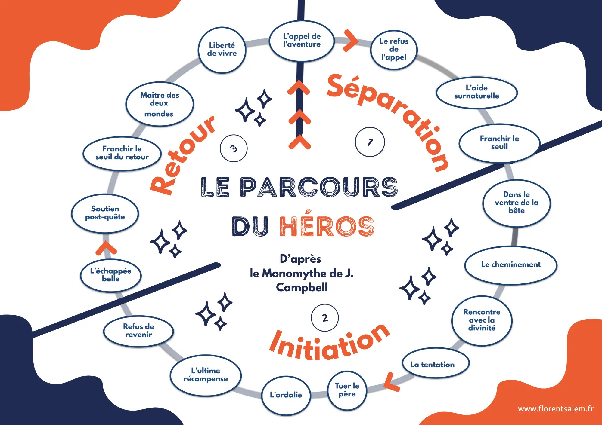

## La force de nos croyances

D’où viennent ces croyances que nous nous sommes attardés à décortiquer ? Comment se sont-elles construites ? Pourquoi perdurent-elles ? Il existe une convergence forte d'intérêts à promouvoir l’idée centrale, numéro une dans notre développement précédent, d’un parapente sûr, à risque maîtrisable.

### Un développement historique centré sur la justification sécuritaire de la pratique

C’est déjà le sens de l’histoire. Les pionniers ont réellement dû apprendre à maîtriser leurs engins et leur propre activité. Ils connaissaient peu de choses au sujet de leur environnement et de l’aérologie. Il est difficile de nous rappeler d’où nous venons cinquante ans en arrière mais les premiers deltaplanes étaient livrés en kit à monter soi-même et avaient parfois pour toute explication une simple feuille A4 d’instructions. Certains pionniés ont même conçu et construit eux-mêmes leur deltaplane, leur parapente ou leur biplace. Le seul apprentissage possible était le compagnonnage de quelqu’un qui en avait déjà fait un petit peu ou la pratique expérimentale par essai et erreur, souvent entre copains. Pas étonnant dans ce contexte que la volonté de maîtrise soit centrale dans l’imaginaire collectif des libéristes.

« C’était risqué avant, on n’y connaissait rien et on faisait n’importe quoi ».   
« S’il y avait vraiment trop de vent d’un côté de la montagne, on descendait un peu le versant de l’autre côté pour aller décoller à l’abri. »  
« On est des survivants. »

Les témoignages invitent à la comparaison avec l’effort indéniable de sécurisation qui a effectivement été entrepris depuis quelques décennies. Cette sécurisation a été une nécessité : il a fallu montrer que cette activité comportait peut-être quelques risques… mais qu’ils étaient maîtrisables \! En tant que communauté, nous avons produit cet effort au point de nous en convaincre nous-mêmes.

En effet, les anciens ont senti bien avant nous la façon dont la société impose une injonction d’aseptisation aux pratiquants des activités à risque. Ce sont les libéristes eux-mêmes qui sont sommés de faire la démonstration d’une pratique sûre ou de risquer l’interdiction pure et simple de leurs nouveaux jouets. L’État régalien pose aussi très vite la question de la façon dont ces activités sont assurées pour les dégâts qu’elles occasionnent. Qui couvre ce risque ? À quel tarif ? Qui a intérêt à le faire si la discipline n’est qu’une forme de roulette russe en plein air ? Aujourd’hui encore, l’assurance en responsabilité civile aérienne est un enjeu central et peut-être la seule forme de réglementation que partagent largement la plupart des nations du monde autour du vol libre.

L’institutionnalisation répond d’ailleurs habituellement à ce besoin d’orthodoxie sécuritaire (concept bien connu en Éducation Physique et Sportive que j'emprunte à Pierre Arnaud[^18]). Il s’agit de trouver une forme de légitimité et les fédérations de parachutisme, de vol à voile et de vol libre visent logiquement à réunir, à représenter et à défendre les intérêts des pratiquants. Sécuriser revêt un intérêt stratégique majeur pour pouvoir développer et démocratiser le deltaplane et le parapente à la façon d’une fédération sportive. Une activité qui paraîtrait peu sûre, a fortiori en l’air avec un engin que le pratiquant ne pourrait pas totalement maîtriser, n’entre pas dans la doxa sportive et risque d’être interdite ou marginalisée. Le base jump ou le wingsuit en sont aujourd’hui la parfaite démonstration et reproduisent le chemin parcouru par les premiers deltistes et plus tard, la bande de copains qui s’amuse à sauter de la montagne à Mieussy avec de pseudo-parachutes. Toutes les communautés naissantes autour de notions « extrêmes » (dangereuses) se retrouvent chargées de montrer patte blanche et de s’organiser pour rendre leur discipline crédible sur le plan sécuritaire.

En deltaplane comme en parapente, les efforts autour de la pédagogie et de l’apprentissage sont immédiats. Très tôt, il est donné la possibilité concrète « d’apprendre » l’activité au travers de stages en école. Des ouvrages pédagogiques formidables apparaissent et avec eux, les premiers moniteurs diplômés qui structurent plus tard les parcours fédéraux. En France, sont apparus des brevets de pilote. Un parcours de formation est né et traite de l'initiation au perfectionnement, avec des moniteurs et des personnes ressources ou spécialisées qui sont clairement identifiées. Partout à travers le territoire, les professionnels sont de formidables catalyseurs de la pratique. Ils sensibilisent, évangélisent et souvent même convertissent un large public à la pratique du vol libre.

Côté matériel, la dynamique est similaire. Bien que les fabricants vantent depuis le tout premier jour la stabilité de leurs productions, le fait est que leurs produits s’améliorent objectivement et sont d’ailleurs soumis à de plus en plus de tests effectués par des laboratoires indépendants. Les homologations EN et LTF, ou même la norme CCC en compétition, témoignent d’autant de tentatives pour rationaliser et fiabiliser le matériel mis à disposition des pratiquants en fonction de leur niveau.

En réalité, énormément d’évolutions dans l’histoire du développement du vol libre peuvent être lues selon le prisme de la sécurisation des pratiques et de la sécurité des pratiquants. Le tout, jusqu’à pouvoir penser effectivement que la période des pionniers est révolue et que le parapente est désormais une activité sûre dans laquelle le pratiquant peut maîtriser les risques. Le mythe de l’activité fiable est d’abord né pour résoudre le reproche principal fait à l’encontre de la discipline. C’est une tentative et une réaction. Pour l’anthropologue et historien René Girard[^19] : « S’il y a un ordre normal dans les sociétés, il doit être le fruit d’une crise antérieure, il doit être la résolution de cette crise ». Nous avons vu que les mythes participent de cet ordre normal des choses et mon hypothèse principale est que nous nous sommes mis à croire dur comme fer en un travail qui est en fait toujours en cours.

### Un imaginaire rassurant

Les bons résultats de l’aviation commerciale donnent une impression concomitante rassurante. Comme l’analyse le journaliste et sociologue Malcolm Gladwell[^20], les accidents sont considérés comme des exceptions. Il est réellement possible de voler en sécurité et l’avion n’est-il d’ailleurs pas le moyen de transport le plus sûr du monde ?

Notre imaginaire ne comprend pas l’incident de vol et ne laisse aucune place aux accidents une fois la traditionnelle période de l’apprentissage écoulée… Nous arrivons à admettre qu’un débutant s’écrase dans sa période d’initiation s’il est mal encadré mais personne ne peut percevoir ce qui pourrait clocher une fois cet apprentissage écoulé et le pilote devenu chevronné. C’est ainsi que de tous les super-héros dotés du pouvoir de voler (Superman, Wonder Woman, Peter Pan…), de moyens volants (Iron Man, Harry Potter…), ou même du pouvoir voisin de s’affranchir de la gravité (Spider-Man, Batman…), personne ne s’écrase jamais une fois la partie initiatique achevée alors qu’ils sont pourtant nombreux à tomber durant cette première phase d’apprentissage. À la rigueur, l’imaginaire accepte un éventuel problème mécanique de l’engin qui sert le vol comme pouvant être une cause de défaillance temporaire mais pas plus. La raison est simple : puisque le super-héros est parfait, il n’est pas atteint par les problématiques de facteur humain et donc il n’a jamais d’accident de vol. Ceux qui tombent ne sont pas des super-héros et tout concorde pour croire que les accidents sont dus à des erreurs humaines (mythe \#2) et qu’il n’existe aucune limite au vol (mythe \#4).

### Une rhétorique nécessaire

En dépit de décennies d’efforts de sécurisation massifs, concrets et confluents de multiples volontés et acteurs, les accidents demeurent. La communauté ne les comptabilise toujours pas très bien, mais tout le monde le sait.

La justification primaire et naturelle avancée par le milieu provient d’abord de l’effet « tête brûlée ». C’est vrai que dans les premières années et en même temps que l’effort de pédagogie déployé un peu partout pour enseigner, démocratiser et donner une image plus fiable de nos pratiques, de nombreux débutants continuaient de se former seuls ou avec leur bande de copains. Cet usage n’est d'ailleurs toujours pas révolu et il ne fait nul doute que la probabilité d’accident avec ce style d’auto-initiation est largement supérieure aux approches plus professionnelles et encadrées. De nombreux problèmes ont ainsi été rapportés et logiquement le mythe de l’accident « dû à des erreurs humaines » s’est renforcé.

- « La pratique n’est pas si dangereuse et on l’enseigne bien mais ce sont de vraies têtes brûlées et ils font n’importe quoi ».

De nos jours, le terme de « têtes brûlées » est de plus en plus remplacé par celui « d’inconscients » mais l’argument reste le même. C’est celui qui contribue à faire de la victime un bouc émissaire.  

Les efforts fédéraux et commerciaux autour de la démocratisation des pratiques ainsi que le réseau de professionnels se développant sur le territoire, avec des intérêts forts autour des enjeux de formation et de gestion de flux touristiques, expliquent bien l’articulation entre les deux premiers mythes. En caricaturant à peine, le discours ambiant est alors : « Le parapente c’est super \! Il faut venir essayer, tout le monde peut apprendre mais pour échapper à l’accident, il faut se former et / ou être bien encadré ». C’est sans doute dans les années fastes (90) que cette croyance se radicalise le plus. Des enfants de 10 ans sont en l’air, des voiles apparaissent dans les enseignes sport pour tous comme Décathlon, de grandes marques envisagent alors d’investir dans ce qui sera peut-être un sport de masse dans le futur.

Les victimes générées par nos activités enrayent un business qui pourrait être bien plus important et la pression collective et sociale qui repose sur les accidentés ne diminue pas. Ici je souhaite présenter encore une nouvelle illustration de cette ambivalence de victime / bouc émissaire qui contribue à accentuer la force de nos croyances.

### Le mythe d’Icare en renfort \!

Si nous reprenons la mythologie grecque, Dédale dit bien à son fils Icare de ne voler ni trop bas pour ne pas alourdir ses ailes avec l’humidité de la mer, ni trop haut pour ne pas faire fondre les ailes de plumes et de cire qu’il lui a confectionnées. Comme chacun sait, l’histoire se termine mal parce que le fils n’écoute pas son père. La morale est donc que l’accident arrive par inexpérience, défaut de respect des consignes ou orgueil. C’est la conséquence d’une erreur humaine et c’est la faute de l’accidenté.

Malheureusement, il y a encore plus pernicieux. Dans notre écosystème en effet, tous les acteurs ont un intérêt direct à culpabiliser le pilote accidenté : 

Les copains pratiquants veulent continuer de croire que leur sport est sûr et souhaitent continuer à voler. Le fabricant de voile garantit que sa machine est conforme et souhaite continuer à en vendre d’autres. Le moniteur met systématiquement hors de cause son enseignement et souhaite continuer à enseigner. La fédération comptabilise, analyse, sensibilise (dans le meilleur des cas) et souhaite continuer à recevoir des adhérents.

C’est important de comprendre que la logique de la victime / bouc émissaire, pour ancrée symboliquement qu’elle soit, trouve aussi des racines dans la recherche de responsabilité suite à un accident. C’est plus pratique, à tous points de vue, pour le système et pour ses acteurs, de penser que les victimes ont fait des erreurs et qu’elles en assument désormais les conséquences. C'est aussi aisément rationalisable rétrospectivement et c’est une tendance qui, pour le coup, se retrouve complètement dans l'aviation civile ou commerciale. En fait, personne ne peut jamais dire, ne serait-ce qu’une seule fois : « quelque chose en dehors du pilote a défailli \! » 

Penser qu’Icare est fautif permet de ne pas demander à Dédale pourquoi il n’a pas utilisé quelques fils de soie s’il savait que la cire allait fondre. Pourquoi a-t-il fait voler son jeune fils si longtemps et par-dessus les mers dès le premier essai ? Nous voyons un gamin perdre la tête et mourir de son orgueil mais nous oublions de questionner ce qui aurait pu être mis en place pour éviter le drame. Nous passons sous silence ce qui a dysfonctionné et nous ne parlons pas de ce que nous devrions en conclure pour les futurs vols.

Le mythe \#3 d’un pilote seul capable d’assurer sa sécurité provient de là. « Seul maître à bord après Dieu » n’est pas tant un slogan pour donner au pilote les pleins pouvoirs afin de mener à bien sa mission. C’est en fait ce que tout le monde souhaite. Cela place implicitement le pratiquant en responsable d’une défaillance potentielle : si quelque chose ne va pas, ce sera par sa faute. Le plus surprenant, c’est que très souvent, les pilotes eux-mêmes souscrivent à cette pensée pour son corollaire qui sous-entend que si tout se passe bien, alors ce sera grâce à eux.

### Le succès des uns, l’erreur des autres

Il existe une explication assez simple, presque mécanique, à notre manie de charger l’accidenté. Elle tient à la façon dont nous attribuons des causes à ce qui nous arrive. Dans *On parie ?*, l’ancienne joueuse de poker professionnelle Annie Duke la décrit très bien[^c-duke]. Quand tout se passe bien pour nous, nous y voyons le fruit de notre compétence. Quand tout se passe bien pour les autres, nous y voyons volontiers de la chance. À l’inverse, nos propres échecs relèvent de la malchance, tandis que ceux des autres s’expliquent par leurs erreurs.

Ce mécanisme est connu depuis longtemps en psychologie sociale. Fritz Heider a montré dès 1958 que nous cherchons sans cesse à expliquer les comportements, en les attribuant soit à la personne (son caractère, sa compétence), soit à la situation (les circonstances, le hasard)[^c-heider]. Plusieurs biais systématiques se sont greffés sur cette théorie de l’attribution :

- **Le biais d’autocomplaisance.** Nous attribuons nos réussites à nos qualités et nos échecs aux circonstances, ce qui protège l’estime de soi[^c-miller-ross].
- **L’erreur fondamentale d’attribution.** Pour expliquer le comportement d’autrui, nous surestimons le poids de sa personnalité et de ses choix, et nous sous-estimons celui de la situation[^c-ross].
- **L’asymétrie acteur-observateur.** Quand nous agissons, nous voyons surtout la situation qui nous contraint. Quand nous observons, nous voyons surtout la personne qui agit[^c-jones-nisbett].
- **La croyance en un monde juste.** Nous avons besoin de croire que chacun obtient ce qu’il mérite, au point de chercher, chez la victime, ce qui pourrait justifier ce qui lui est arrivé[^c-lerner].

Appliqués au vol libre, ces biais produisent exactement ce que nous avons décrit dans les pages précédentes. Le pilote qui rentre d’un vol difficile s’attribue le mérite d’avoir bien géré, alors que la masse d’air l’a peut-être simplement épargné. Le pilote qui se fait une frayeur parle de « conditions pourries ». Mais lorsqu’un autre se blesse ou se tue, nous cherchons d’abord ce qu’il a mal fait : il volait trop près du relief, sa voile était trop exigeante, il n’aurait pas dû décoller. C’est ce qui nous permet de conclure : « ça ne m’arrivera pas, à moi ». L’attribution n’est pas seulement une erreur de raisonnement individuelle. Elle est la matière première du bouc émissaire, et elle nourrit le mythe d’un pilote seul maître de sa sécurité.

Ce biais n’épargne personne, pas même nos meilleurs pilotes. Antoine Girard, recordman du monde de distance, aventurier et véritable héros de notre communauté, le dit avec une grande franchise[^c-girard] :

> « En parapente, c’est nous qui prenons les risques. Il n’y a pas de côté aléatoire, il n’y a pas de rafale de vent qui arrive d’un seul coup. Ces choses-là n’existent pas, il y a très peu d’accidents où on n’est pas responsable. Je ne dis pas que je ne mourrai pas en parapente, parce que l’accident peut arriver, mais si je meurs, à 98 %, voire 99 % de chances, c’est que j’ai fait une erreur. Et donc si je meurs, ce sera de ma faute. Alors qu’en montagne… j’ai eu suffisamment de copains qui ont disparu. Il n’y a aucune erreur, tout le monde est là et il y a une personne dans le groupe qui disparaît, malheureusement. Une pierre au mauvais endroit, n’importe quoi, on ne sait jamais quand ça tombe. »

Dans un autre entretien, la même année, il revient sur ce qui l’a éloigné de l’alpinisme de haut niveau[^c-girard-2] :

> « La notion de risque pour moi était très, très importante, parce que dans le milieu de l’alpinisme, quand on pratique assez poussé, à haut niveau […], la mort est omniprésente. […] Je trouvais ça très, très injuste parce que c’était la roulette russe, en fait : tu marches, t’as pas l’impression de prendre de risque, personne ne prend de risque, et il y a un mec devant toi qui disparaît parce qu’il prend une pierre, une avalanche, il prend un truc, alors que toi, deux minutes derrière, t’as rien. Et en fait, je n’accepte pas, ou je n’acceptais vraiment pas, cette prise de risque aléatoire, alors qu’en parapente… je ne dis pas qu’il y a moins d’accidents, tout ça… En parapente, je pense que tous ceux qui ont un accident, qui se tuent ou qu’il y a un problème, c’est à 95, voire à 98 %, à la base, une erreur humaine. On est beaucoup moins voué à l’aléatoire. Si un jour je meurs en parapente, c’est que j’aurai fait une erreur, donc j’aurais pu l’éviter. J’aurai fait une erreur, donc c’est la conséquence. »

Il ne s’agit pas ici de critiquer Antoine Girard. Son discours est celui d’un pilote d’exception, cohérent avec sa pratique et avec l’exigence qu’il s’impose. C’est précisément ce qui le rend si révélateur : au sommet de notre discipline, la croyance est à son pinacle : en montagne, le hasard tue. En parapente, ce serait toujours le pilote. Les déclarations d’accidents racontent une autre histoire. En 2024 et 2025, les fermetures en vol sont la première cause de décès déclarés en parapente, et lorsqu’elles commencent près du sol, le pilote n’a souvent ni le temps de récupérer sa voile ni celui de lancer son secours (voir « Connaître nos accidents »). Une rafale qui arrive d’un seul coup, cela existe (voir « Le rejet de l’aléa et de l’incertitude », mythe \#4). Attribuer 98 % des décès à l’erreur du pilote, c’est exactement ce que décrit la théorie de l’attribution : une manière de garder le contrôle sur ce qui, en partie, nous échappe. Ce n'est pas parce que cela se perçoit moins qu'en alpinisme que cela n'existe pas. « Un mec devant toi qui disparaît […] alors que toi, deux minutes derrière, t’as rien » : c'est exactement ce qui se passe aussi en parapente, par moments.

### Le voyage du héros

Ici je dois traiter de la partie immergée de l’iceberg et la raison pour laquelle je pense que toutes les croyances mises en exergue dans la première partie de cet ouvrage font des dégâts. En 1949, Joseph Campbell a publié un essai de mythologie comparée resté célèbre : *Le Héros aux mille et un visages*. Il y postule l’existence d’un monomythe, sorte d'archétype structurant de l’ensemble des mythes et contes populaires dans nos sociétés. Chaque auteur et chaque époque semblent rejouer systématiquement la même histoire, le même « voyage du héros ». Campbell décrit avec précision les étapes de ce périple.

**  
*Infographie \- Les étapes du parcours du héros avec l’aimable autorisation de Florent Salem https\://www\.florentsalem.fr/concept-le-monomythe-de-campbell*

Même si l’exactitude des analyses mythologiques de Campbell est très controversée, ce voyage a effectivement été repris par de nombreux auteurs et par l’industrie cinématographique à succès. Il est troublant de constater à quel point le voyage du héros ressemble comme deux gouttes d’eau à l’aventure entreprise par un parapentiste ; que ce soit au plan macroscopique (à l'échelle de sa carrière de libériste) ou à l’échelon microscopique (c'est-à-dire à chacun de ses vols).

Le cycle séparation, initiation, retour est celui que nous expérimentons tous en allant voler et il est tout à fait propre aux sports à risque dans leur dimension incertaine et donc ordalique. Une hypothèse qui ne manquera pas d’être impopulaire dans notre communauté est que par désir mimétique (de nouveau René Girard[^21]) les pilotes se fantasment en héros au travers de leur pratique personnelle. À l’instar de Michel Bernard[^22] qui écrivait : « le corps est le symbole dont use une société pour parler de ses fantasmes », je crois que les activités à risque sont le symbole dont use notre société pour fantasmer des héros.

En clair, je dis qu'après des années de consommation de ce genre de scénarios « romano-héroïques », nous, pratiquants du parapente, avons éprouvé le besoin de nous projeter par mimétisme sur une histoire semblable. Devenir les héros de notre réalité. Cette notion semble très voisine du statut de surhomme ou de la volonté de puissance détaillée par Friedrich Nietzsche[^23]. Par contre, c’est important de noter d’emblée que cette recherche n’est pas nécessairement narcissique. Les récompenses que nous venons chercher sont diversifiées et ont trait aux différentes logiques de liberté promises par notre activité. Nous l’avons vu, les facettes en sont multiples. Cela va de la recherche d’émancipation, de soif de connaissance, d’accès à la culture de l’air à des notions contemplatives, intérieures, esthétiques, en passant par la recherche d’adrénaline (dopamine), les besoins de maîtrise, d’appartenance ou aussi c’est vrai, le narcissisme entre autres… Aucun de ces objectifs n’exclut par ailleurs les autres et chacun nourrit une motivation singulière plus ou moins consciente et plus ou moins autodéterminée (voir à ce sujet Ryan et Deci[^24]).

Toutefois, j’ai expliqué en amont à quel point la liberté du vol libre est en fait celle de la transgression et du rapport à la limite. Le fait de pouvoir trouver une distinction avec le commun de ses semblables ou par rapport à une ancienne version de soi-même. Revenir avec cette récompense suppose ici d’accomplir un cycle de voyage complet avec une mise à l’épreuve significative et incertaine. Soit le voyageur est effectivement l’élu et alors il trouvera en chemin et en lui des ressources pour passer l’épreuve, soit ce n’est pas le cas et donc il échouera. 

Un piège potentiel se révèle dès lors que la distinction ne s’effectue que comparativement à une communauté d’origine. Le simple fait de décoller un parapente suffit bien à être une transgression pour les quidams de la société civile et pour autant cela ne suffit plus quand le héros appartient désormais à un univers où tout le monde le fait déjà… La limite est repoussée et avec elle naît la nécessité d’un nouveau voyage et d’une nouvelle transgression pour obtenir à nouveau le statut recherché au sein de la communauté. Les stars de notre pratique sont celles et ceux qui ont réchappé de multiples voyages. L’événement roi est celui où le vainqueur démontre au monde entier l’étendue de son pouvoir de transgression en pulvérisant toutes les limites possibles et imaginables : c’est la X-Alps.

Tout se passe donc comme si parallèlement au discours ambiant de la communauté promouvant des disciplines aseptisées et grand public, les pratiquants se livraient en réalité à des voyages initiatiques et des rituels beaucoup plus lourds de sens. La justification et la démocratisation de nos activités cachent la réalité de ce qu’elles sont fondamentalement : un formidable espace créatif permettant à des citoyens de retrouver du sens, de se confronter en nature et en pratique à la symbolique du voyage du héros, ordalie comprise et par là même de ressentir une infinie sensation de liberté.

Ces rites et symboliques sont peut-être répandus ailleurs dans notre société mais s’agissant des sports à risque ils mettent radicalement en jeu l’intégrité physique. Les victimes du parapente se reconnaissent elles-mêmes coupables d’avoir échoué à une épreuve auto-infligée. La culpabilité est ici celle de la décision du départ et de l’appel à l’aventure : « Je n’aurais pas dû partir », ou celle de l’impréparation : « Je n’étais pas en état ». « Je n’étais pas prêt ». « J’étais fatigué ». Ce syndrome du transgresseur signe et rationalise l’échec du héros. Il reste aux accidentés deux options : continuer de se projeter et réentreprendre un voyage après une période de convalescence (l’accident est alors perçu comme une épreuve de plus, une embûche sur le chemin) ou accepter son humble condition et se retirer de l’activité en oubliant le projet d’aller chercher ses récompenses.

J'ai quelque chose de plus dur encore à écrire. Dans ce système, la mort de nos proches est malheureusement la preuve que l’ordalie était réelle (voir « La liberté du vol libre »). Une épreuve dont tout le monde reviendrait ne serait pas une épreuve. Ce sont nos amis disparus qui donnent au voyage son poids, et c’est terrible à dire. Ils sont, malgré nous, la justification ultime du héros. Certains n’en reviennent pas ; moi si. Le simple fait d’être revenu souligne la puissance de ce que l’on a traversé. Même lorsque l'interprétation qui nous reste est le hasard (« Je suis un miraculé »), cela donne l’impression, à soi-même et au monde, d’être une forme d'élu. Les proches partis deviennent, malgré eux, les faire-valoir de ceux qui restent. Ce n’est pas un jugement, j'en fais partie. C’est l’histoire que nous nous racontons qui leur fait jouer ce rôle.

Encore une fois, ce mécanisme est moins fort dans les activités où la mort est perçue comme une tombola. En alpinisme, Antoine Girard le disait plus haut, une pierre tombe sur l’un et épargne celui qui marche deux minutes derrière : le survivant sait qu’il a eu de la chance. En parapente, c’est l’inverse. Puisque nous croyons que presque tous les accidents viennent d’une erreur du pilote, celui qui revient ne doit rien au hasard. S’il est revenu, c’est que ses compétences à lui n’ont pas défailli. Il n’est pas chanceux : il est surpuissant.

A l'extrême, la communauté a même un mot pour ces élus : les « SkyGods », les dieux du ciel[^c-skygod]. L’expression dit à elle seule la hiérarchie ordalique entre les pilotes. Le SkyGod est celui qui a passé le plus d’épreuves, celui dont les compétences supposées lui permettent d’affronter des cieux toujours plus déchaînés. On le regarde décoller quand les autres restent au sol, et l’on se dit que lui, il sait. Les statistiques rappellent pourtant que les dieux du ciel sont de bien humbles mortels. Le profil type du déclarant d’accident dressé par la FFVL n’est pas celui d’un débutant, mais celui d’« un pilote masculin de plus de 40 ans volant plutôt régulièrement, breveté confirmé qui s’accidente dans l’après-midi sur un site connu plutôt en fin de vol »[^c-ffvl-profil]. Et les mathématiques d’une carrière de pilote (voir « Qui compte nos morts ? ») ne font aucune exception : plus on vole longtemps, plus le risque s’accumule. Or les SkyGods sont précisément ceux qui volent le plus, le plus longtemps et dans les conditions les plus fortes. Les pilotes de très haut niveau tombent et meurent aussi, ils sont juste statistiquement moins nombreux que les pilotes lambdas.

Ceux qui reviennent racontent leur voyage, et ceux qui ne reviennent pas ne racontent plus rien. C’est là que ce mécanisme rejoint l’attribution causale évoquée plus haut. Les statisticiens appellent cela le biais du survivant : on tire des leçons des seuls cas qui ont survécu à la sélection, et l’on oublie tous les autres. Le pilote revenu attribue naturellement son retour à sa compétence, à son jugement, à sa préparation. La part de chance disparaît de son récit, et avec elle, la possibilité de comprendre ce qui a tué les autres.

De façon cruciale, notons que ce qui permet de se projeter dans ce voyage du héros (en pilote de parapente plutôt que dans un autre style d'aventure) provient justement de notre système de croyance. La combinaison des mythes 1 et 2 d’une activité conçue comme sûre mais qu’il s’agirait de dompter afin d’en réchapper autorise une forme d'ordalie « douce » dans laquelle les pratiquants modernes peuvent s’investir en ayant le sentiment de prendre un risque modéré, qu’ils vont pouvoir en fait gérer. C'est ainsi que la communauté éloigne la pratique d'autres « roulettes russes » comme l'alpinisme dont parle Antoine Girard. Le mythe \#3 du pilote seul maître de sa destinée est l’écho même du héros : c’est lui et personne d’autre qui doit se prendre en main pour passer l’épreuve, et, s’il en revient, s’en attribuer tout le mérite. Le mythe \#4 dans lequel aucune condition ne semble trop forte à qui sait les surpasser participe encore de ce même imaginaire. Enfin, la déformation de la théorie homéostatique du risque vise à garantir que si le héros dispose d’un soutien trop fort alors il devra choisir une quête plus difficile pour atteindre son but.

La symbolique du voyage du héros renforce maintenant les mêmes croyances qui ont permis son implantation profonde dans notre imaginaire. Il n’en a pourtant pas toujours été ainsi.

### La dynamique évolutive des croyances

Nos croyances se construisent, évoluent et se renforcent au fil du temps et des acteurs qui peuplent notre communauté. Il est amusant de constater comment les acteurs successifs et les conceptions relatives à l’activité se déterminent mutuellement. D’une part, ce sont les croyances qui attirent une typologie particulière de pratiquants tandis que dans le même temps, ce sont ces derniers qui contribuent à modifier légèrement les conceptions, permettant l’arrivée de nouveaux membres, un peu différents, qui à leur tour façonnent de nouvelles croyances. Le sens de ce développement est favorable à une large démocratisation du vol libre au fur et à mesure que la croyance en sa fiabilité s’établit. 

Contrairement à ce que l’on croit intuitivement, le deltaplane et le parapente des débuts ne sont en effet pas des activités ayant attiré seulement des risque-tout et des fous furieux. Elles intéressent en fait au départ des profils extrêmement polarisés. On y découvre très vite des acteurs focalisés sur le loisir, la recherche de glisse et de sensations fortes mais en amont et à l’exact opposé, il y a aussi des gens à la compétence technique éprouvée, plutôt centrés sur la compréhension des phénomènes aérodynamiques et la maîtrise des aéronefs. Des hippies, des ingénieurs. Des inventeurs presque hippies et presque ingénieurs aussi. Nos activités ne seraient rien sans les « Géo Trouvetou » qui s’inscrivent dans cette activité pour tendre le pont nécessaire entre des enjeux de fun, d’adrénaline en plein air d’un côté et la rigueur et la science nécessaires au vol de l’autre. Pendant que ces pionniers tentent de rendre les engins un peu plus coopératifs et performants, le public qui peut se retrouver dans ce genre de pratique est constitué principalement de deux types : soit les expérimentés et hauts techniciens des disciplines voisines ou même de l’armée qui sont conscients des risques et des dangers inhérents à ces disciplines nouvelles ; soit des profils avec une compétence professionnelle très éloignée mais en totale recherche de sensations fortes tels que les décrit Marvin Zuckerman[^25].

À mesure que les premiers inventeurs s’efforcent de sécuriser la discipline et que les mentalités évoluent lentement sous l’impulsion des formes primitives d'institutionnalisation, le public change et s’étoffe par des profils extrêmement pointus. Souvent ce sont d’abord des moniteurs et des pratiquants d’activités de plein air habitués à l’incertitude et à la gestion des risques. C’est le temps des guides, des moniteurs de ski, des grimpeurs, des pilotes d’autres engins. En ce temps-là, il faut présenter un certain pedigree pour se convertir en libériste parce que le mythe d’une pratique sûre est encore en construction. Cela nécessite soit une grande compétence, soit un bon peu d’ego et certains acteurs emblématiques historiques sont célèbres pour avoir bien mélangé les deux.

Ce milieu se stabilise pendant les années 1990, avant que le parapente ne fasse mouche chez les professeurs, les instituteurs, et les autres métiers de la connaissance. Ce seront les premières personnes plus typées « grand public », sensibles à la possibilité offerte de maîtriser un engin dans un environnement aérien. Pourtant, l’activité n’est pas encore conçue « grand public » à proprement parler mais la pédagogie débarque et contribue à penser la démocratisation du parapente comme un nouveau possible.

L'effervescence intellectuelle est importante, le maillage territorial des professionnels s’organise et contribue à convertir une part plus large de la population déjà séduite et désormais convaincue par le discours sécuritaire et l’apparente facilité du parapente. Le système s’emballe à ce moment-là, parce que voir tout le monde le faire renforce le sentiment de sécurité. C’est le moment où l’activité intègre plus largement des publics historiquement éloignés des disciplines aériennes : les jeunes, les féminines, les personnes en situation de handicap. C’est le temps des professeurs d’EPS, de l’UNSS, des STAPS et du SUAPS. Seuls les rappels du réel et de lourds accidents (tout profil) enrayent encore partiellement la démocratisation de nos activités. 

Nous nous trouvons aujourd’hui dans cette forme de rappel avec un parapente devenu protéiforme : speed-riding, speed-flying, vol-et-ski, parakite, voltige, freestyle, marche-et-vol, paralpinisme, soaring, en compétition ou en loisir, débutant vs. confirmé, vol de distance (cross), précision d'atterrissage, treuil... Qui veut quoi ? La démocratisation puis la diversification jusqu’à l’individualisation (\!) des activités physiques en pleine nature les ont fait tellement exploser (Christian Pociello[^26]) qu’il devient difficile de penser que tout ce monde s’engage dans des activités où la gestion des risques est en fait peu fiable. Nos croyances se renforcent aussi de cette dynamique de démocratisation alors que dans les faits nos systèmes collectifs de sécurisation n’ont pas suivi la cadence et peinent à se structurer. C’est ce paradoxe que nous vivons. Comment fonctionne encore cet effort de démocratisation aujourd’hui ?

### La dynamique de la démocratisation

La typologie des pratiquants du vol libre s’est diversifiée au rythme de la croyance en la fiabilité des engins. Notre activité se transmet d’abord par proximité idéologique. Le « virus » que le débutant attrape en devenant « mordu » de vol, c’est en fait une confiance nouvelle dans un monde jusqu’ici non envisagé. Plus l'individu baigne dans le système de croyance d’un parapente sûr et plus il est susceptible de devenir pratiquant à son tour. Les familles font pratiquer leurs enfants parce qu’elles croient en une activité pouvant être apprise / acquise et en un risque raisonnable pouvant se maîtriser. Les fils de moniteurs ou de personnalités de notre communauté volent en quasi-totalité depuis leur plus jeune âge. La plupart des parents ne se posent même pas la question. Dans une moindre mesure, les conjoint(e)s, les frères et sœurs, les cousin(e)s… utilisent aussi souvent un vecteur familial pour démarrer. Ce mode de transmission est extrêmement efficace puisqu’il est direct et intime. Les valeurs sont partagées à l'échelon familial ou dans la sphère immédiate. Le taux de conversion / transmission est quasiment plein.

À peine plus éloignées du monde du vol, les populations montagnardes ou très proches des activités de plein air sont aussi facilement séduites par le parapente parce qu’il est facile de comparer cette discipline, en matière de risque, avec les autres disponibles dans leur environnement. Meurt-on plus en ski, en escalade, en trail, en VTT ou en parapente ? Peu importe au fond. Les individus placent volontiers ces activités comme des endroits où la mort survient généralement pour cueillir des imprudents… En fait, la logique entretenue par la communauté libériste est déjà là, présente et sous-jacente ailleurs. Le transfert est facile. Ce vecteur de transmission est efficace avec des parallèles et des rapprochements des plus marqués entre les sports : paralpinisme, combo, vol-et-ski, marche-et-vol… Cette propagation est rapide.

Les écoles professionnelles, associatives et les réseaux sociaux se chargent de convertir le reste des troupes. Les chiffres du parapente démontrent une pratique centrée essentiellement autour d’un produit de consommation touristique. Dans le milieu, on entend souvent dire que moins de 5 % des stagiaires d’initiation ou des passagers de biplace continuent ensuite à voler. Je n’ai trouvé aucune donnée publiée pour le confirmer, et c’est là encore un chiffre que personne ne mesure. Mais aucun professionnel ne prétend que la proportion est élevée. On vient y chercher des sensations, des souvenirs, un moment d’adrénaline, de belles photos pour les réseaux, une image audacieuse en dehors du temps, en vacances… Cette voie de démocratisation draine un flux massif qui explique qu’en dépit du petit taux de conversion dont nous avons parlé, de nombreux pilotes se convertissent chaque année par l’activité professionnelle, associative et touristique.   

L’ensemble des dynamiques de démocratisation du vol libre entretient une progression régulière des licenciés de la fédération française : 34 387 en 2023, 34 744 en 2024, 36 189 en 2025 et 37 680 en 2026[^c-ffvl-effectifs]. C’est près de 10 % de plus en trois ans, et plus de 4 % par an sur les deux dernières années. À ce rythme, et même en considérant seulement les licenciés, le nombre de pratiquants sur notre territoire doublerait en moins de vingt ans.

Cette démocratisation et cette attractivité incontestable est née de la propagation de nos propres mythes communautaires. Nous avons globalement réussi à convaincre que le parapente était une activité à risque maîtrisable. Nous diminuons tous les jours la perception du risque inhérent au vol avec nos aéronefs, alors que dans le même temps la symbolique héroïque et l'imaginaire du vol restent intacte. En conséquence des gens d'un milieu toujours plus éloigné des sports de nature, de la gestion des risques et du milieu aéronautique souhaitent nous rejoindre et voler. Je ne critique pas ce mouvement, je le décris. J'en suis directement issu. Rien ne me destinait à voler, mes parents ont cru (surtout mon papa) que c'était suffisamment sûr parce que c'est ce qu'on leur a expliqué.

[^18]:  Voir l’article : Contribution à une histoire des disciplines d'enseignement paru dans la Revue française de pédagogie en 1989\.

[^19]:  René Girard en 1994 dans : « Quand ces choses commenceront »

[^20]:  Malcolm Gladwell en 2008 dans : « Outliers: The Story of Success ».

[^21]:  René Girard en 1961 : Mensonge romantique et vérité romanesque

[^22]:  Michel Bernard en 2000 : La chair et le verbe paru dans la revue Corps et Culture

[^23]:  Friedrich Nietzsche dès 1885 : Ainsi parlait Zarathoustra

[^24]:  Ryan et Deci en 1985 : Théorie de l’autodétermination

[^25]:  Marvin Zuckerman en 1994 dans : « Behavioral expressions and biosocial bases of sensation seeking ».

[^26]:  Christian Pociello en 1995 : Les cultures sportives

[^c-duke]:  Annie Duke en 2018 : *Thinking in Bets*. Traduction française de Tina Calogirou : *On parie ? Prendre les bonnes décisions sans avoir toutes les cartes en main*, Alisio, 2024, chapitre « Hasard ou compétence : analyser les résultats », p. 110, et plus précisément la section « Comment les résultats des autres nous impactent », p. 133.

[^c-heider]:  Fritz Heider en 1958 : *The Psychology of Interpersonal Relations*.

[^c-miller-ross]:  Dale T. Miller et Michael Ross en 1975 : « Self-serving biases in the attribution of causality: Fact or fiction? », *Psychological Bulletin*, 82(2), p. 213-225.

[^c-ffvl-effectifs]:  Nombre de licenciés FFVL de 2023 à 2026, intranet fédéral (intranet.ffvl.fr), communiqué à l’auteur. Calculs de l’auteur.

[^c-ross]:  Lee Ross en 1977 : « The intuitive psychologist and his shortcomings: Distortions in the attribution process », *Advances in Experimental Social Psychology*, vol. 10, p. 173-220.

[^c-jones-nisbett]:  Edward E. Jones et Richard E. Nisbett en 1971 : *The Actor and the Observer: Divergent Perceptions of the Causes of Behavior*.

[^c-lerner]:  Melvin J. Lerner en 1980 : *The Belief in a Just World: A Fundamental Delusion*.

[^c-girard]:  Antoine Girard, entretien pour Primetalk, 15 septembre 2026 : https://www.youtube.com/watch?v=4bOyL2z8olA&t=1035s (à 17 min 15). Citation transmise par l’auteur ; seules l’orthographe et la ponctuation ont été légèrement corrigées.

[^c-girard-2]:  Antoine Girard, entretien pour le podcast Aventure épique, 7 mai 2026 : https://open.spotify.com/episode/3CRsNV3knjUiUgZqg2owpy (à 14 min 16). Citation transmise par l’auteur ; seules l’orthographe et la ponctuation ont été légèrement corrigées.

[^c-skygod]: L’expression vient du monde anglophone. On la trouve par exemple dans l’article d’Ian Blackmore cité plus haut (voir « Mythe #5 ») : « Local SkyGods launch into thermal on their deathships » (les dieux du ciel locaux s’élancent dans le thermique sur leurs voiles de la mort), Paragliding Forum, fil « Active flying - How YOU do it? », 2008 : https://www.paraglidingforum.com/viewtopic.php?p=p517110

[^c-ffvl-profil]: FFVL, « Sécurité Parapente. Et si on parlait sécurité ? », diaporama de sensibilisation (fichier créé en janvier 2016), d’après 1 896 déclarations d’accident de 2010 à 2013 : https://federation.ffvl.fr/sites/ffvl.fr/files/ARTICLE_diaporama_securite.pdf
